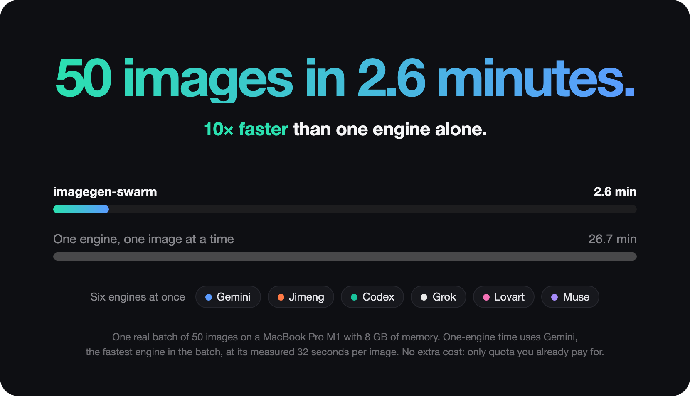

# imagegen-swarm

<p align="center">
  <a href="LICENSE"></a>
  &nbsp;
  <a href="https://github.com/Ekko237/imagegen-swarm/releases/latest"></a>
  &nbsp;
  <a href="CHANGELOG.md"></a>
</p>

<p align="center">
  <a href="README.zh-CN.md">中文说明</a>
</p>

**A Claude Code and Codex skill that runs batch image and video generation across six engines in parallel.** No image API key needed for most engines—use the Codex, Jimeng, Grok, Gemini, and Muse accounts you already have.

* **Codex, Jimeng, Grok, Gemini, Muse**: use your existing account logins. (Jimeng also generates videos.)
* **Lovart**: uses its official AK/SK, stored on your machine.

Give `imagegen-swarm` a list of jobs and it feeds all six engines at once. Free lanes pull the next image from a shared queue, finishing batches in minutes. When one engine hits its quota limit, the remaining engines pick up its work.

<p align="center">
  
</p>



## How the work is shared

Each engine opens multiple lanes. Every free lane grabs the next job in the queue. If an engine runs out of quota, the others take over. In the 50-image test run above, Gemini and Lovart hit their limits partway through, and the remaining engines still delivered all 50 images.

It is one test run, so your numbers will differ: your speed will depend on your account quotas. In this run, Lovart and Muse were on free plans, and Gemini and Lovart ran out midway. With more quota, all engines stay active to the end and a batch usually finishes faster.


## Why

Image tools give you weekly or monthly quotas that mostly sit unused. Running one engine at a time is slow and stops at its limit. `imagegen-swarm` puts all your accounts on a single queue:

* **Parallel**: every engine runs multiple lanes at once; any free lane grabs the next compatible job.
* **Quota-aware**: if an engine reports exhausted quota, a missing login, or a missing install, it shuts down and returns its job to the queue. Plain rate limits trigger a backoff and only shut the engine down after three in a row.
* **Correct**: checks every file to confirm it is new from this run, re-runs wrong aspect ratios on another engine, and output is always real PNG.
* **Fits your machine**: lane counts scale with RAM, from 12 lanes on a 4 GB laptop to 34 on 16 GB or more. Want to keep memory free for other apps? Cap memory usage with `IMAGE_GEN_MEMORY_GB=4`, or set exact lane counts with `--lanes gemini=2,codex=2`.
* **Resumable**: rerun the same job list and already-finished images are skipped.

## Engines

| Engine | Can do | Runs through |
| --- | --- | --- |
| **codex** | images, reference images | Codex CLI's built-in `image_gen` (your Codex / ChatGPT login) |
| **jimeng** | images, edits (up to 10 references), text- and image-to-video | the official Dreamina CLI (your Douyin login) |
| **grok** | images, edits, reference-to-video | Grok Build CLI's Imagine tools |
| **gemini** | images, edits (up to 3 references) | Antigravity CLI's `generate_image` |
| **muse** | images, reference images | Muse (muse.ai) driven by a headless browser |
| **lovart** | images, reference images | the official Lovart CLI (your AK/SK) |

You only need one engine logged in. Every engine you add makes batches faster.

## Install

```bash
npx skills add https://github.com/Ekko237/imagegen-swarm -a claude-code -a codex
```

That installs the skill with the npx skills CLI and works across Claude Code, Codex and other agents.

<details>
<summary>Claude Code plugin</summary>

Claude Code:

```bash
claude plugin install imagegen-swarm --marketplace Ekko237/imagegen-swarm
```

</details>

<details>
<summary>Codex plugin</summary>

Codex:

```bash
codex plugin marketplace add Ekko237/imagegen-swarm
codex plugin add imagegen-swarm@imagegen-swarm
```

</details>

These commands install the skill. You still need Node.js 18+ and Python 3 with Pillow (`python3 -m pip install pillow`) on macOS, Windows, or Linux. Log in to at least one engine before generating. Lovart requires its official AK/SK.

Verify: ask your agent to draw a lemon slice on a blue background. You should get a new PNG, and the run log will record which engine made it.

<details>
<summary>Folder install, npx, and Windows</summary>

### Folder

Copy or symlink `skills/imagegen-swarm` into your agent skills directory. The folder must be named `imagegen-swarm`.

```bash
git clone https://github.com/Ekko237/imagegen-swarm.git
mkdir -p ~/.claude/skills ~/.codex/skills
ln -s "$PWD/imagegen-swarm/skills/imagegen-swarm" ~/.claude/skills/imagegen-swarm
ln -s "$PWD/imagegen-swarm/skills/imagegen-swarm" ~/.codex/skills/imagegen-swarm
```

To copy instead of symlink, replace `ln -s` with `cp -a`. Update a symlink install with `git pull` inside the clone, or update a copy by copying the folder again. If you have an older install named `image-gen`, rename it to `imagegen-swarm`.

### npx skills

```bash
npx skills add https://github.com/Ekko237/imagegen-swarm -a claude-code -a codex
```

### Windows

Copy `skills/imagegen-swarm` to `%USERPROFILE%\.claude\skills\imagegen-swarm` or `%USERPROFILE%\.codex\skills\imagegen-swarm`. On Windows, the scripts call `python` (or use the `PYTHON` env var). Install Pillow with `python -m pip install pillow`. The Jimeng installer requires Git Bash. Engine login steps are in [SETUP.md](skills/imagegen-swarm/SETUP.md).

Check which engines are ready from the skill folder:

```bash
node scripts/check.mjs
```

From a repo clone, run `node skills/imagegen-swarm/scripts/check.mjs`.

</details>

## Usage

Ask your agent for images to trigger the skill automatically, or run a batch directly from the CLI:

```bash
cat > jobs.json <<'EOF'
[
  {"id": "lemon",  "prompt": "a lemon slice on a blue background, flat illustration", "aspect": "1:1"},
  {"id": "kite",   "prompt": "a red kite in a clear sky, minimal",                    "aspect": "3:4"},
  {"id": "whale",  "prompt": "a blue whale in the deep ocean, low poly",              "aspect": "16:9"},
  {"id": "night",  "prompt": "the same lemon slice, but at night", "ref": ["out/lemon.png"]}
]
EOF
node skills/imagegen-swarm/scripts/batch.mjs --jobs jobs.json --out out/
```

Each job requires `id` and `prompt`; `aspect`, `ref`, `video`, and `engine` are optional. Output saves to `out/<id>.png`, progress streams as JSON lines, and `out/batch-results.json` records which engine made each image.

You can also call a single engine directly: `node skills/imagegen-swarm/scripts/gemini-image.mjs --prompt "..." --out a.png --aspect 1:1`. Full options are in [SKILL.md](skills/imagegen-swarm/SKILL.md). When running from the installed skill folder, drop the `skills/imagegen-swarm/` prefix.

## Common questions

**Do I need every engine logged in?**

No. One is enough, and each engine you add speeds up batches. Set up only the ones you want. Run `node skills/imagegen-swarm/scripts/check.mjs` to see which engines are ready. Any engine without a login shuts down and returns its job to the queue.

**Is my login safe?**

The skill contains no accounts or keys. Each engine stores its login in its own local folder—do not bundle those folders if you share the skill. Put Lovart's AK/SK in `~/.lovart/env` with mode `600`, never in chat or git. All credential paths are listed in [SETUP.md](skills/imagegen-swarm/SETUP.md).

**What happens when a quota runs out?**

When an engine reports exhausted quota, no login, or no install, it shuts down and puts its current image back in the queue. A standard rate limit (429) backs off and only shuts the engine down after three consecutive rate-limit failures. Failed images retry on another untried engine, up to `--tries` engines (default 3). If every engine runs out of quota, generate in the ChatGPT, Gemini, or Grok web app in a new tab, download and check the image, then close the tab. An engine error is not an empty quota. If the engine you named fails, the skill reports that error.

**Do I need an API key?**

Not for most engines. Codex and Jimeng use the accounts you already have. Grok, Gemini, and Muse use their own account logins. Only Lovart requires its official AK/SK, stored on your machine.

**Which agents does this run in?**

Claude Code and Codex.

<details>
<summary>Tests</summary>

```bash
node skills/imagegen-swarm/evals/run.mjs out/                         # every fixed task, including a mixed batch
node skills/imagegen-swarm/evals/run.mjs out/ --only gemini-t2i,batch-mixed
node skills/imagegen-swarm/scripts/reliability.test.mjs               # log parsing, rate limits, steal threshold, Lovart wrapper
python3 skills/imagegen-swarm/scripts/reliability_rename_test.py      # Muse rename does not block generation
```

</details>

<details>
<summary>Layout</summary>

```
├─ skills/imagegen-swarm/   the skill: SKILL.md, SETUP.md, scripts, references, evals
├─ docs/                    README images
├─ AGENTS.md                entry point for an agent handed this repo
├─ CHANGELOG.md             release notes
├─ .claude-plugin/          Claude Code plugin manifest (skills: ./skills/imagegen-swarm)
├─ .codex-plugin/           Codex plugin manifest (skills: ./skills/)
├─ .agents/                 Codex marketplace manifest
└─ .github/                 CI and bug report template
```

</details>

## Credits

The Codex instruction template follows the `baoyu-image-gen` codex-imagegen wrapper; see [NOTICE](NOTICE) for the upstream MIT attribution.

## License

MIT, see [LICENSE](LICENSE).

Tried it? Open an issue and tell me what broke or what you made.
