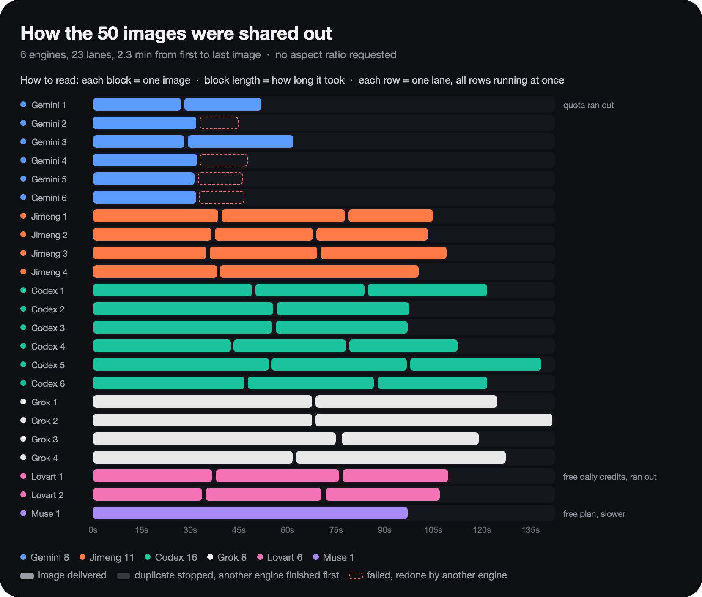

# imagegen-swarm

<p align="center">
  <a href="LICENSE"></a>
  &nbsp;
  <a href="https://github.com/Ekko237/imagegen-swarm/releases/latest"></a>
  &nbsp;
  <a href="CHANGELOG.md"></a>
</p>

<p align="center">
  <a href="README.zh-CN.md">中文说明</a>
</p>

<p align="center">
  
</p>

<p align="center">
  <em>Generation time only, from one test run. The 2.3 minutes and the 11× line end when the files are written. Screening and style redos sit outside that clock. See <a href="#keep-rate">Keep rate</a>.</em>
</p>

**A Claude Code and Codex skill that runs batch image and video generation across six engines in parallel.** No image API key needed for most engines—use the Codex, Jimeng, Grok, Gemini, and Muse accounts you already have.

* **Codex, Jimeng, Grok, Gemini, Muse**: use your existing account logins. (Jimeng also generates videos.)
* **Lovart**: uses its official AK/SK, stored on your machine.

Give `imagegen-swarm` a list of jobs and it feeds all six engines at once. Free lanes pull the next image from a shared queue. The minutes in the chart are generation time only. When one engine hits its quota limit, the remaining engines pick up its work.

**New in 1.3.0: [series mode](#series-mode).** For the same character, the same brand, or a cover set, every engine shares one style guide.

**New in 1.3.1: an informational series-mode hint.** It never turns series mode on by itself; generation behavior is unchanged.

**Fixed in 1.3.3: fail-closed Muse approvals.** Free-text cards no longer grant permission. Only a verified single image-save operation for the exact output path may be approved. No live card layout is verified yet, so Muse jobs stop instead of clicking unrecognized approval cards. See [Muse approval details](skills/imagegen-swarm/references/muse.md).

## How the work is shared

Each engine opens multiple lanes. Every free lane grabs the next job in the queue. If an engine runs out of quota, the others take over. In the 50-image test run above, Gemini and Lovart hit their limits partway through, and the remaining engines still delivered all 50 images.

The 2.3 minutes on that chart is generation time only: the wall clock until the last of those 50 files was written. Screening the images, and regenerating any that miss a character or a brand, sit outside that clock. The 11× line compares that 2.3 minutes with 26.7 minutes for one engine, using Gemini, the fastest engine in that run, at its measured 32 seconds per image. Both sides are generation time only. The run's log is not in this repository, so the chart has no keep rate. [Keep rate](#keep-rate) explains how to count one.

It is one test run, so your numbers will differ: your speed will depend on your account quotas. In this run, Lovart and Muse were on free plans, and Gemini and Lovart ran out midway. With more quota, all engines stay active to the end and generation usually finishes faster.



## Why

Image tools give you weekly or monthly quotas that mostly sit unused. Running one engine at a time is slow and stops at its limit. `imagegen-swarm` puts all your accounts on a single queue:

* **Parallel**: every engine runs multiple lanes at once; any free lane grabs the next compatible job.
* **Quota-aware**: if an engine reports exhausted quota, a missing login, or a missing install, it shuts down and returns its job to the queue. Plain rate limits trigger a backoff and only shut the engine down after three in a row.
* **Correct**: checks every file to confirm it is new from this run, re-runs wrong aspect ratios on another engine, and output is always real PNG.
* **Fits your machine**: lane counts scale with RAM, from 12 lanes on a 4 GB laptop to 34 on 16 GB or more. Want to keep memory free for other apps? Cap memory usage with `IMAGE_GEN_MEMORY_GB=4`, or set exact lane counts with `--lanes gemini=2,codex=2`.
* **Resumable**: rerun the same job list and already-finished images are skipped.
* **Optional paid last resort**: add a pay-per-image API line (OpenAI or Gemini API). It only takes images no subscription engine can take, so the queue keeps going when every quota runs dry at once, and it stops at the per-batch and per-month budgets you set.

## Engines

| Engine | Can do | Runs through |
| --- | --- | --- |
| **codex** | images, reference images | Codex CLI's built-in `image_gen` (your Codex / ChatGPT login) |
| **jimeng** | images, edits (up to 10 references), text- and image-to-video | the official Dreamina CLI (your Douyin login) |
| **grok** | images, edits, reference-to-video | Grok Build CLI's Imagine tools |
| **gemini** | images, edits (up to 3 references) | Antigravity CLI's `generate_image` |
| **muse** | images, reference images | Muse (muse.ai) driven by a headless browser |
| **lovart** | images, reference images | the official Lovart CLI (your AK/SK) |
| **api** (optional, paid) | images, edits | OpenAI Images API or Gemini API with your own key, pay per image |

You only need one engine logged in. Every engine you add makes generation faster.

## Install

```bash
npx skills add https://github.com/Ekko237/imagegen-swarm -a claude-code -a codex
```

That installs the skill with the npx skills CLI and works across Claude Code, Codex and other agents.

<details>
<summary>Claude Code plugin</summary>

Claude Code:

```bash
claude plugin install imagegen-swarm --marketplace Ekko237/imagegen-swarm
```

</details>

<details>
<summary>Codex plugin</summary>

Codex:

```bash
codex plugin marketplace add Ekko237/imagegen-swarm
codex plugin add imagegen-swarm@imagegen-swarm
```

</details>

These commands install the skill. You still need Node.js 18+ and Python 3 with Pillow (`python3 -m pip install pillow`) on macOS, Windows, or Linux. Log in to at least one engine before generating. Lovart requires its official AK/SK.

Verify: ask your agent to draw a lemon slice on a blue background. You should get a new PNG, and the run log will record which engine made it.

<details>
<summary>Folder install, npx, and Windows</summary>

### Folder

Copy or symlink `skills/imagegen-swarm` into your agent skills directory. The folder must be named `imagegen-swarm`.

```bash
git clone https://github.com/Ekko237/imagegen-swarm.git
mkdir -p ~/.claude/skills ~/.codex/skills
ln -s "$PWD/imagegen-swarm/skills/imagegen-swarm" ~/.claude/skills/imagegen-swarm
ln -s "$PWD/imagegen-swarm/skills/imagegen-swarm" ~/.codex/skills/imagegen-swarm
```

To copy instead of symlink, replace `ln -s` with `cp -a`. Update a symlink install with `git pull` inside the clone, or update a copy by copying the folder again. If you have an older install named `image-gen`, rename it to `imagegen-swarm`.

### npx skills

```bash
npx skills add https://github.com/Ekko237/imagegen-swarm -a claude-code -a codex
```

### Windows

Copy `skills/imagegen-swarm` to `%USERPROFILE%\.claude\skills\imagegen-swarm` or `%USERPROFILE%\.codex\skills\imagegen-swarm`. On Windows, the scripts call `python` (or use the `PYTHON` env var). Install Pillow with `python -m pip install pillow`. The Jimeng binary for Windows is `dreamina.exe`; the pinned checksum is in [SETUP.md](skills/imagegen-swarm/SETUP.md).

Check which engines are ready from the skill folder:

```bash
node scripts/check.mjs
```

From a repo clone, run `node skills/imagegen-swarm/scripts/check.mjs`.

</details>

## Usage

Ask your agent for images to trigger the skill automatically, or run a batch directly from the CLI:

```bash
cat > jobs.json <<'EOF'
[
  {"id": "lemon",  "prompt": "a lemon slice on a blue background, flat illustration", "aspect": "1:1"},
  {"id": "kite",   "prompt": "a red kite in a clear sky, minimal",                    "aspect": "3:4"},
  {"id": "whale",  "prompt": "a blue whale in the deep ocean, low poly",              "aspect": "16:9"},
  {"id": "night",  "prompt": "the same lemon slice, but at night", "ref": ["out/lemon.png"]}
]
EOF
node skills/imagegen-swarm/scripts/batch.mjs --jobs jobs.json --out out/
```

Each job requires `id` and `prompt`; `aspect`, `ref`, `video`, and `engine` are optional. Output saves to `out/<id>.png`, progress streams as JSON lines, and `out/batch-results.json` records which engine made each image, how long that attempt took, and the `keep` counts below.

## Series mode

Series mode is off by default and is never enabled automatically. It came from user feedback on X about style consistency across engines. When you mention the same character, brand, mascot, a cover set, or a series, or every task shares the same style reference image, the assistant first asks: “Should this batch share one style? If so I'll turn on series mode.” It enables the mode only after you agree, using your description for `series.style` and the shared reference image(s) for `series.ref`. Without a clear signal, such as 50 font images in different styles, there is no reminder.

The CLI prints one bilingual `series_hint` JSON event to stderr only when `--series` is absent, the jobs file has no `series` key (including a plain array), there are at least 4 jobs, and every job has an identical non-empty reference list. Paths are resolved relative to the jobs file with `path.resolve`; order and duplicate counts must match. Filesystem symlinks are not resolved, empty path strings do not qualify, and prompt similarity is not used. Any explicit `series` value, including `false` or `null`, suppresses the hint. The message suggests adding `--series` if the jobs should share one style.

When emitted, `series_hint: true` appears in the final summary and `out/batch-results.json`; otherwise the field is omitted. The hint is informational only: it never enables series mode, prompts, waits, or changes engines, provider calls or arguments, environment, or exit codes.

After agreement, in the jobs file, beside the job list:

```json
"series": {"style": "...", "ref": ["style.png"]}
```

```bash
node skills/imagegen-swarm/scripts/batch.mjs --jobs jobs.json --out out/ --series --style "..." --style-ref style.png
```

* One style guide and the style reference images go to every engine.
* Each image is screened on palette and brightness. An outlier is discarded and put back on the queue, preferring the most consistent engine so far.
* The summary counts those discards in `keep.style_redos`. `delivery_seconds` is the wall clock until the summary, including that screening and those redos.

The score is palette and brightness only. It does not recognize a face, a character, or a logo. A keep rate was not measured on a real multi-engine series. All options are in [SKILL.md](skills/imagegen-swarm/SKILL.md#series-mode).

## Keep rate

Count three different things: images an engine returned, images saved as the job output, and images you still want after you look at them.

The 50-image run delivered 50 files. That is the number on the chart. This repository does not include that run's `batch-results.json` or a screening log, so it has no measured keep rate for the run.

After a batch, the last JSON line and `out/batch-results.json` include `keep`, counted from the attempts in that run:

| Field | What it counts |
| --- | --- |
| `generated` | Attempts where the engine returned an image file |
| `kept` | Those files saved as `out/<id>.png` (`.mp4` for video) after the automatic checks |
| `redone` | Returned files dropped because the aspect ratio was off by more than 3%, then put back on the queue |
| `duplicates` | Extra files from a tail steal. The first copy to finish is the one in `kept`; the other is dropped |
| `style_redos` | Returned files dropped because a series-mode style score was below the threshold. This is 0 when series mode is off |
| `resumed` | Jobs skipped because the output file was already on disk. These sit outside `generated` |

`generated` adds up as `kept` + `redone` + `duplicates` + `style_redos`. An engine error, a timeout, or a quota failure returns no file, so it stays out of `keep`. The job is still retried on another engine, up to `--tries` (default 3). `done` on the same summary is saved jobs plus resumed jobs. `elapsed_seconds` is generation time only. `delivery_seconds` is the wall clock until the summary, and in series mode that includes style screening and style redos.

`keep` counts those automatic checks: the file is new from this run, it is not a copy of a reference image, the aspect ratio is within 3% when the job set one, and, in series mode, the palette score is at least the threshold. The palette score does not judge character identity. The fixed tasks in `tests/evals/evals.json` use a 1–5 content rubric, and a pass is 4 or higher. A batch eval writes the same `keep` object onto its result line. The repository stores the rubric and does not store scored runs.

For a same-character, same-brand, or cover series, see [series mode](#series-mode). Still look at every kept file.

To measure a style keep rate without series mode:

1. Run the batch.
2. Read `keep` for the automatic counts.
3. Look at every file and count how many you would ship. That count is your usable number.
4. Delete the files you reject and run the same job list again. Files still on disk are skipped. A new job for an outlier works the same way. Each replacement is a redo.
5. Add the time you spent screening and regenerating to `elapsed_seconds`. That sum is delivery time. Series mode records the same kind of total as `delivery_seconds`.

`elapsed_seconds` alone is generation time only. The 50-image chart has no measured keep rate.

You can also call a single engine directly: `node skills/imagegen-swarm/scripts/gemini-image.mjs --prompt "..." --out a.png --aspect 1:1`. Full options are in [SKILL.md](skills/imagegen-swarm/SKILL.md). When running from the installed skill folder, drop the `skills/imagegen-swarm/` prefix.

## Sample output

Sample images drawn by the engines.

<p align="center">
  
</p>

## Common questions

**Do I need every engine logged in?**

No. One is enough, and each engine you add speeds up generation. Set up only the ones you want. Run `node skills/imagegen-swarm/scripts/check.mjs` to see which engines are ready. Any engine without a login shuts down and returns its job to the queue.

**Is my login safe?**

The skill contains no accounts or keys. Each engine stores its login in its own local folder—do not bundle those folders if you share the skill. Put Lovart's AK/SK in `~/.lovart/env` with mode `600`, never in chat or git. All credential paths are listed in [SETUP.md](skills/imagegen-swarm/SETUP.md).

**Will styles stay consistent across models?**

Not by default. Each job carries its own `prompt`, an optional `ref` list, and an optional `aspect`, and a free lane that can take the job runs it, so one batch is often split across models.

For the same character, the same brand, or a cover series, use [series mode](#series-mode).

Jimeng takes up to 10 references, Gemini up to 3, and Grok one. Gemini may rewrite the prompt; its result then has `prompt_verbatim: false`.

**What happens when a quota runs out?**

When an engine reports exhausted quota, no login, or no install, it shuts down and puts its current image back in the queue. A standard rate limit (429) backs off and only shuts the engine down after three consecutive rate-limit failures. Failed images retry on another untried engine, up to `--tries` engines (default 3). If you configured the pay-per-image api line, it takes over from there until its budget is used. If every engine runs out of quota, generate in the ChatGPT, Gemini, or Grok web app in a new tab, download and check the image, then close the tab. An engine error is not an empty quota. If the engine you named fails, the skill reports that error.

**Do I need an API key?**

Not for most engines. Codex and Jimeng use the accounts you already have. Grok, Gemini, and Muse use their own account logins. Only Lovart requires its official AK/SK, stored on your machine. The optional pay-per-image line uses your own OpenAI or Gemini API key; see [SETUP.md](skills/imagegen-swarm/SETUP.md).

**Which agents does this run in?**

Claude Code and Codex.

<details>
<summary>Tests</summary>

```bash
node tests/evals/run.mjs out/                         # every fixed task, including a mixed batch
node tests/evals/run.mjs out/ --only gemini-t2i,batch-mixed
node tests/reliability.test.mjs               # log parsing, rate limits, steal threshold, Lovart wrapper
node tests/series.test.mjs                    # series anchor, mock engines, palette score
python3 tests/reliability_rename_test.py      # Muse rename and fail-closed approval checks
```

</details>

<details>
<summary>Layout</summary>

```
├─ skills/imagegen-swarm/   the skill: SKILL.md, SETUP.md, scripts, references
├─ docs/                    README images
├─ tests/                   reliability and series tests; tests/evals/ has the eval runner and spec
├─ examples/                example job files and the Lovart wrapper script
├─ AGENTS.md                entry point for an agent handed this repo
├─ CHANGELOG.md             release notes
├─ .claude-plugin/          Claude Code plugin manifest (skills: ./skills/imagegen-swarm)
├─ .codex-plugin/           Codex plugin manifest (skills: ./skills/)
├─ .agents/                 Codex marketplace manifest
└─ .github/                 CI and bug report template
```

</details>

## Credits

The Codex instruction template follows the `baoyu-image-gen` codex-imagegen wrapper; see [NOTICE](NOTICE) for the upstream MIT attribution.

## License

MIT, see [LICENSE](LICENSE).

Tried it? Open an issue and tell me what broke or what you made.

If this saved you some time, a ⭐ helps other people find it. Issues and PRs welcome — see [CONTRIBUTING.md](CONTRIBUTING.md).
