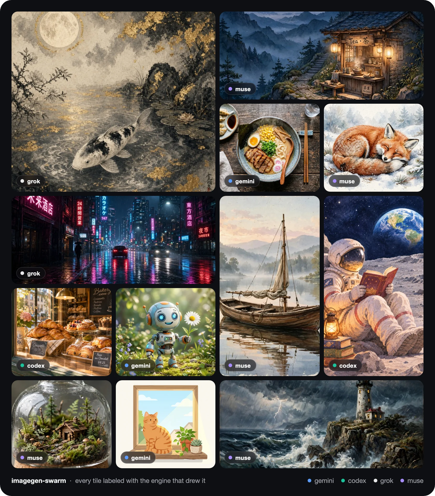
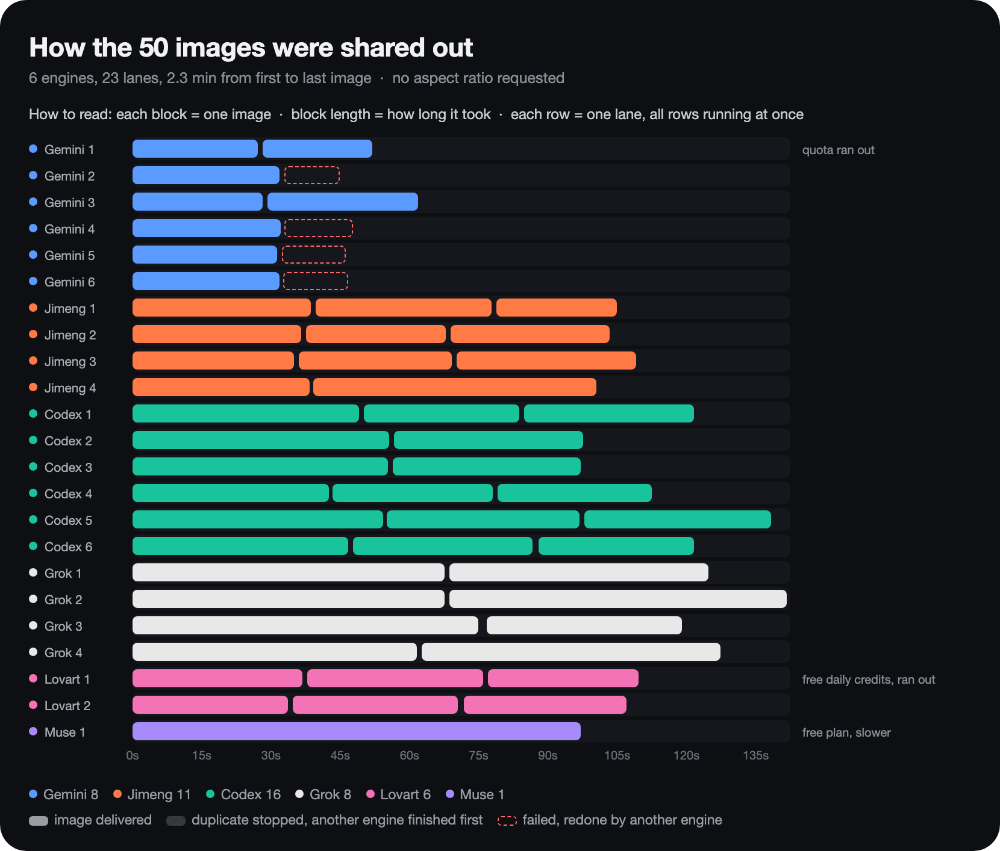

# imagegen-swarm

**Use every AI image quota you already pay for, all at once.** A Claude Code / Codex skill that hands a list of images to Codex, Grok, Gemini, Jimeng, Muse and Lovart in parallel. Whichever engine is free takes the next image, so a batch finishes in minutes, and when one engine runs out of quota the others pick up its work. No image API keys.

[中文说明](README.zh-CN.md)





## Why

Each image tool has its own quota that resets weekly or monthly, and most of it goes unused. One engine alone is slow and stops at its limit. imagegen-swarm puts all of them on one queue:

- **Parallel**: every engine runs a few lanes at once; a free lane grabs the next job it can handle.
- **Quota-aware**: an engine that reports exhausted quota or a missing login is shut down, and its job goes back to the queue.
- **Correct**: every image is checked to be new from this run, wrong aspect ratios are redone by another engine, and output is always real PNG.
- **Resumable**: rerun the same job list and finished images are skipped.

## Engines

| Engine | Can do | Runs through |
|---|---|---|
| **codex** | images, reference images | Codex CLI's built-in `image_gen` (your Codex / ChatGPT login) |
| **jimeng** | images, edits (up to 10 references), text- and image-to-video | the official Dreamina CLI (your Douyin login) |
| **grok** | images, edits, reference-to-video | Grok Build CLI's Imagine tools |
| **gemini** | images, edits (up to 3 references) | Antigravity CLI's `generate_image` |
| **muse** | images, reference images | Muse (muse.ai) driven by a headless browser |
| **lovart** | images, reference images | the official Lovart CLI (your AK/SK) |

You only need one. Every engine you add makes batches faster.

## Install

```bash
git clone https://github.com/Ekko237/imagegen-swarm.git ~/.claude/skills/image-gen   # Claude Code
git clone https://github.com/Ekko237/imagegen-swarm.git ~/.codex/skills/image-gen    # Codex
python3 -m pip install pillow
node ~/.claude/skills/image-gen/scripts/check.mjs                                    # shows which engines are ready
```

Requirements: Node.js 18+ and Python 3 with Pillow, on macOS, Windows or Linux. Log in to the engines you want with [SETUP.md](SETUP.md).

## Usage

Ask your agent for images and the skill triggers. Or run a batch yourself:

```bash
cat > jobs.json <<'EOF'
[
  {"id": "lemon",  "prompt": "a lemon slice on a blue background, flat illustration", "aspect": "1:1"},
  {"id": "kite",   "prompt": "a red kite in a clear sky, minimal",                    "aspect": "3:4"},
  {"id": "whale",  "prompt": "a blue whale in the deep ocean, low poly",              "aspect": "16:9"},
  {"id": "night",  "prompt": "the same lemon slice, but at night", "ref": ["out/lemon.png"]}
]
EOF
node scripts/batch.mjs --jobs jobs.json --out out/
```

Each job needs `id` and `prompt`; `aspect`, `ref`, `video` and `engine` are optional. Output lands in `out/<id>.png`, progress prints as JSON lines, and `out/batch-results.json` records which engine made each image. Single engines also work on their own, e.g. `node scripts/gemini-image.mjs --prompt "..." --out a.png --aspect 1:1`. Full options are in [SKILL.md](SKILL.md).

## Tests

```bash
node evals/run.mjs out/                         # every fixed task, including a mixed batch
node evals/run.mjs out/ --only gemini-t2i,batch-mixed
```

## Layout

```
├─ SKILL.md      skill definition and engine guide
├─ SETUP.md      install and login per engine
├─ AGENTS.md     entry point for an agent handed this repo
├─ scripts/      batch.mjs (work-stealing), one script per engine, jimeng.mjs (Dreamina runner), imgtool.py, check.mjs
├─ references/   codex.md, lovart.md
├─ evals/        fixed tasks with a scoring rubric, run.mjs
└─ docs/         README images
```

## Credits

The Codex instruction template follows the `baoyu-image-gen` codex-imagegen wrapper; see [NOTICE](NOTICE) for the upstream MIT attribution.

## License

MIT, see [LICENSE](LICENSE).
