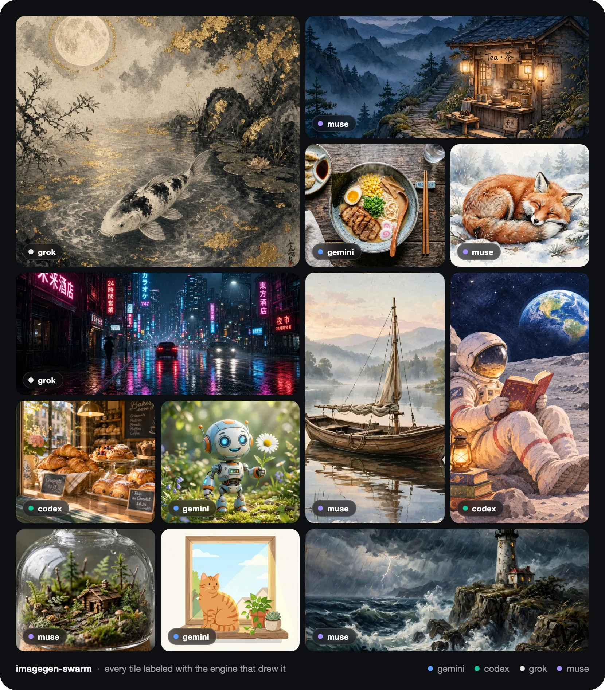
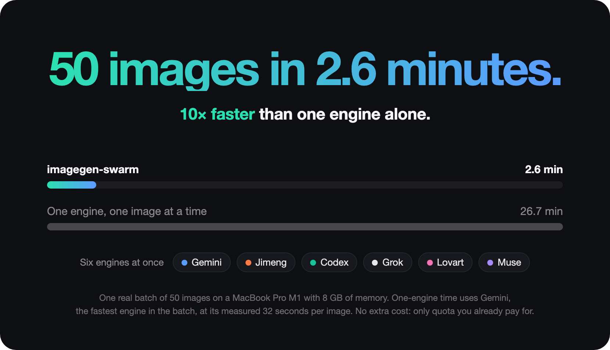

# imagegen-swarm

[English](README.md) | [简体中文](README.zh-CN.md)

Got image-gen quota across several AI tools that goes unused? imagegen-swarm is a Claude Code / Codex skill that puts them all on one queue and fails over when one runs out.

## Who it's for

Indie developers, content creators, and e-commerce sellers who already pay for several AI image subscriptions (Codex, Gemini, Grok, Muse, Lovart, Jimeng / Dreamina, or similar) and need images in batches: covers, article art, product shots, or a set of variants. You only need one engine logged in. Every engine you add makes a batch finish faster.

## Why try it now

Image quotas are scattered across tools, and the weekly or monthly allowance mostly sits unused until it expires. A single engine is slow, and the batch stops when that engine runs out partway through.

In one measured run on an 8 GB M1 MacBook Pro, this queue generated 50 images in 2.3 minutes of generation time, 11 times faster than the fastest engine in that run working alone. Gemini and Lovart hit their limits partway through, and the remaining engines still delivered all 50. Charts and caveats for that run are in [Tested results](#tested-results).

A separate production log covering 30 working days between 2026-09-20 and 2026-11-21 recorded 1,265 images delivered by this skill's engines (codex, jimeng, lovart, gemini, muse, and grok). Two or more of those engines appear on 20 of those 30 days. That log has no per-image timings.

```bash
npx skills add Ekko237/imagegen-swarm@v1.4.2 -a claude-code -a codex
```

[Usage](docs/usage.md) · [Report an issue](https://github.com/Ekko237/imagegen-swarm/issues) · [Contributing](CONTRIBUTING.md) · [ClawHub](https://clawhub.ai/ekko237/skills/imagegen-swarm) · [skills.sh](https://skills.sh/ekko237/imagegen-swarm)

If it helps, a ★ Star helps others find it.

## Requirements

Node.js 18+ and Python 3 with Pillow (`python3 -m pip install pillow`), on macOS, Windows, or Linux. Log in to at least one engine before generating. Lovart requires its official AK/SK. You only need one engine logged in. Every engine you add makes generation faster. Credential paths are in [SETUP.md](skills/imagegen-swarm/SETUP.md).

<p align="center">
  
</p>
<p align="center">
  <em>Real CLI run: six jobs in parallel on one engine (gemini). Multi-engine recording coming.</em>
</p>

<p align="center">
  
</p>
<p align="center">
  <em>Images from six engines, each tile labeled with the engine that drew it: gemini, jimeng, codex, grok, lovart, or muse.</em>
</p>

## Quick use

Ask your agent to draw a lemon slice on a blue background. You should get a new PNG, and the run log will record which engine made it. Log in to at least one engine first; credential paths and CLI install steps are in [SETUP.md](skills/imagegen-swarm/SETUP.md). From the skill folder, `node scripts/check.mjs` lists which engines are ready.

If you installed with the command above, the skill is at `.agents/skills/imagegen-swarm` in the folder where you ran `npx skills add` (Claude Code and Codex also get a link). If the installer asks for confirmation, you can add `-y`. From that skill folder:

```bash
cat > jobs.json <<'EOF'
[
  {"id": "lemon", "prompt": "a lemon slice on a blue background, flat illustration", "aspect": "1:1"}
]
EOF
node scripts/batch.mjs --jobs jobs.json --out out/
```

The file is `out/lemon.png`. If you cloned the repository instead, run the same job from the repository root with `node skills/imagegen-swarm/scripts/batch.mjs --jobs jobs.json --out out/`. If no engine is logged in or its CLI is missing, the run log lists each engine as unavailable; a message like `spawn grok ENOENT` means the Grok CLI is not on PATH. Job fields, the longer example, and calling one engine: [Usage](docs/usage.md).

## When not to use it

- Not for crop, resize, convert, or other ordinary local image processing.
- You need at least one engine logged in, or the optional paid API line configured. With neither, the queue has nothing to run.
- Only Jimeng and Grok can make video. Codex, Gemini, Muse, Lovart, and the optional API line do images (and, where listed below, edits or reference images), not video.

## Compared with alternatives

| | Switching tools by hand | Paying per image via an API | imagegen-swarm |
| --- | --- | --- | --- |
| Setup | Open each tool and paste the prompts yourself | Your own OpenAI or Gemini API key, plus your own scripts or UI | Log in to at least one engine. Lovart needs its official AK/SK |
| Cost model | The subscriptions you already pay for | You pay per image | Uses those same subscription quotas. An optional pay-per-image API line (OpenAI or Gemini API) is a feature of this skill: you can add it as a last resort, with per-batch and per-month budgets you set. It only takes a job when no subscription engine can |
| When a quota runs out | You switch tools and pick up the unfinished jobs yourself | The request fails, or you buy more credits | The engine shuts down and returns its job to the queue; other engines take over. If every subscription is out and you configured the paid line, that line continues until its budget is used |
| Parallelism | Whatever you do in each tool, usually one tool at a time | Depends on the API and whatever you build around it | Each engine opens multiple lanes, and every free lane grabs the next job. Lane counts scale with RAM, from 12 lanes on a 4 GB laptop to 34 on 16 GB or more |

## Engines

| Engine | Can do | Runs through |
| --- | --- | --- |
| **codex** | images, reference images | Codex CLI's built-in `image_gen` (your Codex / ChatGPT login) |
| **jimeng** | images, edits (up to 10 references), text- and image-to-video | the official Dreamina CLI (your Douyin login) |
| **grok** | images, edits, reference-to-video | Grok Build CLI's Imagine tools |
| **gemini** | images, edits (up to 3 references) | Antigravity CLI's `generate_image` |
| **muse** | images, reference images | Muse (muse.ai) driven by a headless browser |
| **lovart** | images, reference images | the official Lovart CLI (your AK/SK) |
| **api** (optional, paid) | images, edits | OpenAI Images API or Gemini API with your own key, pay per image |

## Tested results

50 images in 2.3 minutes, 11× faster than one engine alone (generation time only; see [Keep rate](docs/keep-rate.md)).

<p align="center">
  
</p>

<p align="center">
  <em>Generation time only, from one test run. The 2.3 minutes and the 11× line end when the files are written. Screening and style redos sit outside that clock. See <a href="docs/keep-rate.md">Keep rate</a>.</em>
</p>

Each engine opens multiple lanes. Every free lane grabs the next job in the queue. If an engine runs out of quota, the others take over. In the 50-image test run above, Gemini and Lovart hit their limits partway through, and the remaining engines still delivered all 50 images.

The 2.3 minutes on that chart is generation time only: the wall clock until the last of those 50 files was written. Screening the images, and regenerating any that miss a character or a brand, sit outside that clock. The 11× line compares that 2.3 minutes with 26.7 minutes for one engine, using Gemini, the fastest engine in that run, at its measured 32 seconds per image. Both sides are generation time only. The run's log is not in this repository, so the chart has no keep rate. [Keep rate](docs/keep-rate.md) explains how to count one.

It is one test run, so your numbers will differ: your speed will depend on your account quotas. In this run, Lovart and Muse were on free plans, and Gemini and Lovart ran out midway. With more quota, all engines stay active to the end and generation usually finishes faster.


## Community

Tried it? Open an issue and tell me what broke or what you made. For a bug, attach `out/batch-results.json` after removing keys (including AK/SK), tokens, cookies, account IDs, and personal information. Issues and PRs welcome — see [CONTRIBUTING.md](CONTRIBUTING.md). Setup and quota questions: [Common questions](docs/faq.md).

<p align="center">
  <a href="LICENSE"></a>
  &nbsp;
  <a href="https://github.com/Ekko237/imagegen-swarm/releases/latest"></a>
  &nbsp;
  <a href="CHANGELOG.md"></a>
</p>

MIT, see [LICENSE](LICENSE). The Codex instruction template follows the `baoyu-image-gen` codex-imagegen wrapper; see [NOTICE](NOTICE) for the upstream MIT attribution.

## More

- Parallel lanes, quota failover, file checks, memory, resume, and the optional paid API: [Why](docs/how-it-works.md).
- Plugin, folder, and Windows installs, and the pinned release: [Install](docs/install.md).
- Job fields, the longer batch, and calling one engine: [Usage](docs/usage.md).
- Shared style across a series, off unless you agree: [Series mode](docs/series-mode.md).
- What `keep` counts, and how to measure one yourself: [Keep rate](docs/keep-rate.md).
- Setup, logins, quotas, and API keys: [Common questions](docs/faq.md).
- Test commands: [Tests](docs/tests.md).
- Repository tree: [Layout](docs/layout.md).
