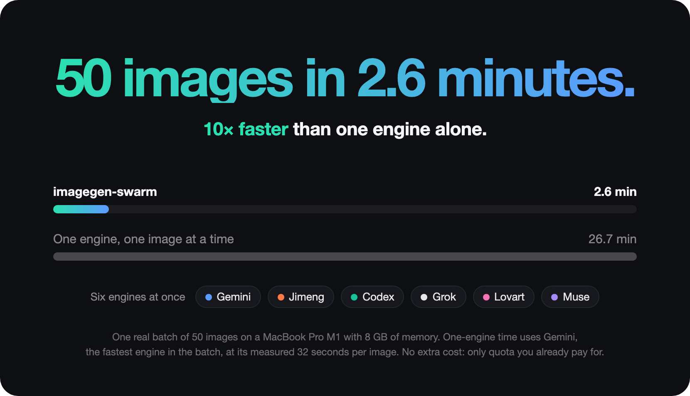
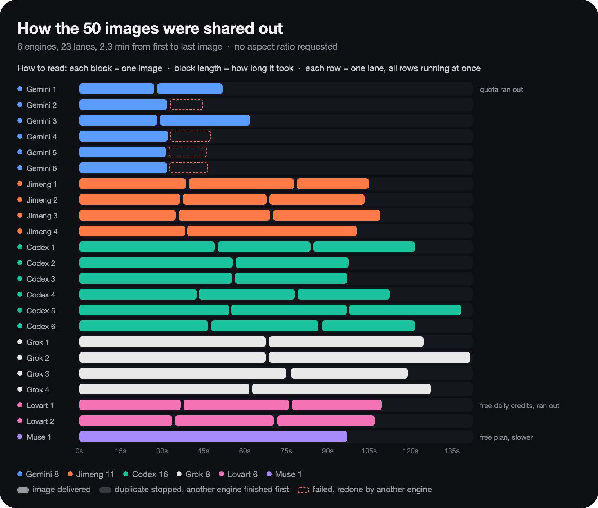
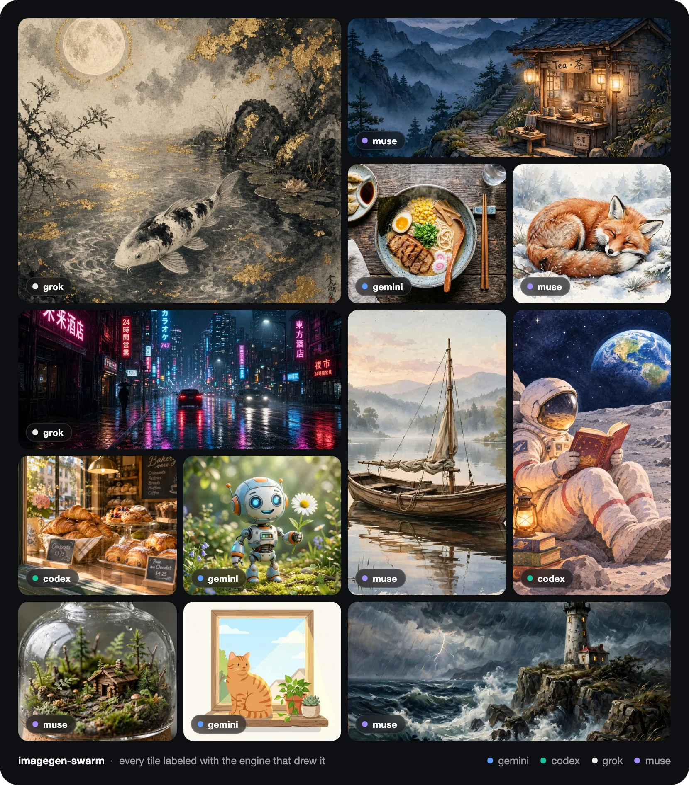

# imagegen-swarm

<p align="center">
  <a href="LICENSE"></a>
  &nbsp;
  <a href="https://github.com/Ekko237/imagegen-swarm/releases/latest"></a>
  &nbsp;
  <a href="CHANGELOG.md"></a>
</p>

<p align="center">
  <a href="README.md">English</a>
</p>

<p align="center">
  
</p>

<p align="center">
  <em>这是一次实测的生成时间。2.3 分钟和 11 倍都算到文件写完为止。筛图和按风格重做不在这段时间里。见<a href="#保留率">保留率</a>。</em>
</p>

**大多数引擎不需要图片 API 密钥。**

用你现有的 Codex 和即梦账号，就能在 Claude Code 里出图。

即梦也能生成视频。
Grok、Gemini、Muse 用各自的账号登录。
Lovart 用官方 AK/SK，凭据保存在本机。

这是一个 Claude Code 和 Codex 技能。
它把一批图同时交给这六家。
哪家空着，就接下一张。
上面图里的分钟数只算生成时间。
某家额度用完，别家接过它的活。

**1.3.0 新增：[系列图模式](#系列图模式)。** 同一角色、同一品牌或一套封面，每家引擎共用一段风格说明。

**1.3.1 新增：系列图模式提醒。** 只提示，不会自动开启，生成行为不变。

**1.3.3 修复：Muse 待确认请求默认拒绝。** 不再按说明文字中的关键词放行。只有能完整解析、且只把一张图保存到本轮精确路径的请求才符合权限范围。目前没有真实卡片样本能验证操作与路径的结构，因此遇到待确认卡片会停止任务，不自动点击。见 [Muse 审批说明](skills/imagegen-swarm/references/muse.md)。

## 活是怎么分的

每家引擎同时开几条通道，每条通道做完一张就接队列里的下一张；某家额度用完，别家接着做。下图就是上面那张结果卡对应的那一批 50 张的真实记录：中途 Gemini、Lovart 额度用完，50 张照样全部交付。

结果卡上的 2.3 分钟只算生成时间：从开工到这 50 张文件写完。看图、以及角色或品牌对不上时的重做，都不在这 2.3 分钟里。11 倍是拿这 2.3 分钟和单引擎的 26.7 分钟比。单引擎用的是这一批里最快的 Gemini，按实测每张 32 秒。两边都只算生成时间。这次运行的日志不在仓库里，所以结果卡上没有保留率。怎么数，见[保留率](#保留率)。

这只是我们的一次测试，你跑出来的数字会不一样：速度取决于你在各家有多少额度。这次 Lovart、Muse 用的是免费额度，Gemini 和 Lovart 还中途用完了；额度更多的话，每家都能一直干到最后，生成通常会比这次更快。



## 为什么做这个

每家出图工具都有自己按周、按月刷新的额度，大多用不完就作废了。只用一家又慢，额度一到就停。imagegen-swarm 把它们放进同一个队列：

- **并行**：每家同时开几条通道，空出来的通道马上接下一张它做得了的图。
- **看额度**：某家报额度用完、没登录或没安装，就关掉它，手上的图退回队列给别家。普通的限流会先退避，连续三次才关掉。
- **保证对**：每张图都核对是这一次新生成的；比例不对的换别家重做；输出一律是真正的 PNG。
- **看电脑配置**：通道数按内存自动定，4GB 的笔记本开 12 条，16GB 以上开 34 条，不会把电脑卡死。想给别的程序留内存，就加 `IMAGE_GEN_MEMORY_GB=4`，或者用 `--lanes gemini=2,codex=2` 直接指定每家几条。
- **能续跑**：同一份清单再跑一次，已经出好的图会跳过。
- **可选的按次付费最后一档**：接一条按张付费的 API 线路（OpenAI 或 Gemini API）。它只接订阅引擎都接不了的图，几家额度同时见底时队列也不会停；花到你定的本批、本月预算就停。

## 引擎

| 引擎 | 能做什么 | 通过什么出图 |
|---|---|---|
| **codex** | 出图、参考图 | Codex 命令行内置的 `image_gen`（用你的 Codex / ChatGPT 登录） |
| **jimeng（即梦）** | 出图、改图（最多 10 张参考图）、文生视频、图生视频 | 即梦官方命令行（用你的抖音登录） |
| **grok** | 出图、改图、参考图生成视频 | Grok Build 命令行的 Imagine 工具 |
| **gemini** | 出图、改图（最多 3 张参考图） | Antigravity 命令行的 `generate_image` |
| **muse** | 出图、参考图 | 用无头浏览器操作 Muse（muse.ai） |
| **lovart** | 出图、参考图 | Lovart 官方命令行（你自己的 AK/SK） |
| **api**（可选，付费） | 出图、改图 | 用你自己 key 的 OpenAI 出图接口或 Gemini API，按张付费 |

有一家就能用，接上的越多，生成越快。

## 安装

```bash
npx skills add https://github.com/Ekko237/imagegen-swarm -a claude-code -a codex
```

这条命令用 npx skills CLI 安装技能，适用于 Claude Code、Codex 和其他 agent。

<details>
<summary>Claude Code plugin</summary>

Claude Code：

```bash
claude plugin install imagegen-swarm --marketplace Ekko237/imagegen-swarm
```

</details>

<details>
<summary>Codex plugin</summary>

Codex：

```bash
codex plugin marketplace add Ekko237/imagegen-swarm
codex plugin add imagegen-swarm@imagegen-swarm
```

</details>

这两段命令安装的是技能本身。你仍需要 Node.js 18+，以及装了 Pillow 的 Python 3（`python3 -m pip install pillow`）。macOS、Windows、Linux 都能用。生成前至少登录一个引擎。Lovart 需要官方 AK/SK。

验证：让你的 agent 画一片蓝底上的柠檬切片。你应该得到一张新的 PNG，这次运行会记下是哪家出的。

<details>
<summary>文件夹安装、npx 和 Windows</summary>

### 文件夹

把 `skills/imagegen-swarm` 复制或软链接到 agent 的技能目录。文件夹必须命名为 `imagegen-swarm`。

```bash
git clone https://github.com/Ekko237/imagegen-swarm.git
mkdir -p ~/.claude/skills ~/.codex/skills
ln -s "$PWD/imagegen-swarm/skills/imagegen-swarm" ~/.claude/skills/imagegen-swarm
ln -s "$PWD/imagegen-swarm/skills/imagegen-swarm" ~/.codex/skills/imagegen-swarm
```

不想用软链接，就把 `ln -s` 换成 `cp -a`。软链接安装后，在克隆出来的仓库里 `git pull` 即更新。复制安装要再复制一次。以前装在 `image-gen` 下的，改名为 `imagegen-swarm`。

### npx skills

```bash
npx skills add https://github.com/Ekko237/imagegen-swarm -a claude-code -a codex
```

### Windows

把 `skills/imagegen-swarm` 复制到 `%USERPROFILE%\.claude\skills\imagegen-swarm` 或 `%USERPROFILE%\.codex\skills\imagegen-swarm`。Windows 上脚本调用 `python`，也可以设置 `PYTHON`。Pillow 用 `python -m pip install pillow` 安装。Windows 上的即梦程序是 `dreamina.exe`，固定校验和写在 [SETUP.md](skills/imagegen-swarm/SETUP.md)（英文）。

在技能文件夹里查看哪几家已经能用：

```bash
node scripts/check.mjs
```

如果是本仓库的克隆，同一条检查是 `node skills/imagegen-swarm/scripts/check.mjs`。

</details>

## 用法

直接跟你的 agent 说要什么图，技能会自动启用。也可以自己跑一批：

```bash
cat > jobs.json <<'EOF'
[
  {"id": "lemon",  "prompt": "a lemon slice on a blue background, flat illustration", "aspect": "1:1"},
  {"id": "kite",   "prompt": "a red kite in a clear sky, minimal",                    "aspect": "3:4"},
  {"id": "whale",  "prompt": "a blue whale in the deep ocean, low poly",              "aspect": "16:9"},
  {"id": "night",  "prompt": "the same lemon slice, but at night", "ref": ["out/lemon.png"]}
]
EOF
node skills/imagegen-swarm/scripts/batch.mjs --jobs jobs.json --out out/
```

每项必填 `id` 和 `prompt`，`aspect`、`ref`、`video`、`engine` 可选。图存在 `out/<id>.png`，进度按行输出 JSON，`out/batch-results.json` 记着每张是哪家出的、花了多久，以及下面的 `keep` 计数。单个引擎的脚本也能单独用，比如 `node skills/imagegen-swarm/scripts/gemini-image.mjs --prompt "..." --out a.png --aspect 1:1`。全部参数见 [SKILL.md](skills/imagegen-swarm/SKILL.md)。在已安装的技能文件夹里，去掉前面的 `skills/imagegen-swarm/`。

## 系列图模式

系列图模式默认关闭，绝不自动开启。这是按 X 上的用户反馈加的：几家引擎一起画，风格要一致。当你提到同一角色、同一品牌、同一吉祥物、一套封面或一个系列，或者每项任务共用同一张风格参考图时，助手会先问一句：「这批要统一风格吗？要的话我打开系列图模式」。只有你同意后才开启，用你自己的描述写 `series.style`，把共用参考图放进 `series.ref`。信号不明确就不提醒，比如 50 张不同风格的字体图，照常生成。

命令行的提醒条件更窄：没传 `--series`、任务文件没有 `series` 键（纯数组也算没有）、至少 4 项任务，并且每项任务都有完全相同的非空参考图列表，才向 stderr 输出一行中英双语的 `series_hint` JSON 事件，提示「这批任务共用同一组参考图，如果要统一风格，可以加 --series」。路径按任务文件所在目录用 `path.resolve` 解析，列表顺序和重复次数都必须一致；不解析文件系统软链接，空路径字符串不算参考图，也不根据提示词相似度判断。显式写了任何 `series` 值，包括 `false` 或 `null`，都不提醒。

发生提醒时，最终摘要和 `out/batch-results.json` 会记 `series_hint: true`；没提醒就省略这个字段。提醒只提供信息，不会开启系列图模式、询问或等待，也不改变引擎、服务调用及参数、环境或退出码。

同意开启后，写在任务文件里，和任务列表并列：

```json
"series": {"style": "...", "ref": ["style.png"]}
```

```bash
node skills/imagegen-swarm/scripts/batch.mjs --jobs jobs.json --out out/ --series --style "..." --style-ref style.png
```

- 同一段风格说明，加上风格参考图，发给每一家引擎。
- 每张图按调色板和亮度打分。分偏低的丢掉，退回队列，优先交给目前风格最齐的那家引擎。
- 摘要里，丢掉的次数在 `keep.style_redos`。`delivery_seconds` 是写到摘要为止的墙钟，含这次打分和这些重做。

这个分数只看调色板和亮度，不认脸、角色或标志。真实的多引擎系列，保留率没有测过。全部参数见 [SKILL.md](skills/imagegen-swarm/SKILL.md#series-mode)。

## 保留率

要分开数三件事：引擎交回了多少张、存成正式文件的有多少张、你看过之后还愿意用的有多少张。

上面那一批交付了 50 张。仓库里没有那次的 `batch-results.json`，也没有筛图记录，所以没有测出来的保留率。

一批跑完，最后一行 JSON 和 `out/batch-results.json` 里有 `keep`，数字来自这一轮的每次尝试：

| 字段 | 数的是什么 |
| --- | --- |
| `generated` | 引擎交回了图片文件的次数 |
| `kept` | 通过自动检查后，存成 `out/<id>.png`（视频是 `.mp4`）的张数 |
| `redone` | 交回的图因为比例偏差超过 3% 被丢掉，退回队列重做的次数 |
| `duplicates` | 抢尾单多做出来的文件。先做完的那份算进 `kept`，另一份丢掉 |
| `style_redos` | 系列模式里风格分低于阈值、文件被丢掉的次数。没开系列模式时是 0 |
| `resumed` | 输出文件已经在磁盘上，这次跳过的任务。不算进 `generated` |

`generated` 等于 `kept` + `redone` + `duplicates` + `style_redos`。引擎报错、超时、额度用完时没有文件，不进 `keep`。这张图仍会换一家再试，最多 `--tries` 家（默认 3）。同一份摘要里的 `done` 是存下来的任务加上跳过的任务。`elapsed_seconds` 只算生成时间。`delivery_seconds` 是写到摘要为止的墙钟，系列模式里含风格打分和风格重做。

`keep` 覆盖这些自动检查：文件是这一次新生成的，不是参考图原样，任务写了比例时偏差在 3% 以内，系列模式里调色板分还要达到阈值。调色板分不判断是不是同一个人。`tests/evals/evals.json` 里的固定任务用 1 到 5 分的内容量表，4 分及以上算通过。批量测试会把同一个 `keep` 写进结果行。仓库里有量表，没有打过分的运行记录。

同一角色、同一品牌或一套封面，见[系列图模式](#系列图模式)。交付前仍要逐张看。

不开系列模式时，风格保留率要自己量：

1. 跑完这一批。
2. 读 `keep`，那是自动计数。
3. 每张都看一遍，数你愿意交付的张数。这就是你的可用数。
4. 删掉不要的，用同一份清单再跑。磁盘上还在的文件会跳过。给不合的那张另开一条任务也一样。每张换掉的都算重做。
5. 把看图和重做花的时间加到 `elapsed_seconds` 上。加总才是交付时间。系列模式把同类的总时间记在 `delivery_seconds`。

单独的 `elapsed_seconds` 只是生成时间。上面那 50 张没有测出来的保留率。

## 样例输出

各家引擎画的样例图。

<p align="center">
  
</p>

## 常见问题

**要六家都登录吗？**

不用。有一家就能用。接上的越多，生成越快。只装你要用的。`node skills/imagegen-swarm/scripts/check.mjs` 会列出哪几家已经能用。没登录的会被关掉，手上的图退回队列。

**登录安全吗？**

技能本身不含账号和密钥。每家的登录留在它自己的目录里。分享这个技能时，不要把那些目录一起打包。Lovart 的 AK/SK 写在 `~/.lovart/env`，权限是 `600`，不要写进对话，也不要写进 git。各家目录见 [SETUP.md](skills/imagegen-swarm/SETUP.md)。

**不同模型画出来，风格会一致吗？**

默认不会。每张图只有自己的 `prompt`、可选的 `ref` 和 `aspect`。哪条通道接得了，就由它画，所以一批图常常分给不同的模型。

同一角色、同一品牌或一套封面，用[系列图模式](#系列图模式)。

即梦最多 10 张参考图，Gemini 最多 3 张，Grok 1 张。Gemini 可能会改写提示词，结果里的 `prompt_verbatim` 就是 `false`。

**额度用完会怎样？**

某家报额度用完、没登录或没安装，技能会关掉它，把它手上的图退回队列。普通的 429 限流会先退避，连续三次才关掉这家。失败的图会换一家还没试过的引擎重做，最多 `--tries` 家（默认 3）。六家都没有额度时，改在 ChatGPT、Gemini 或 Grok 的网页里新开一个标签生成，下载核对后再关掉标签。引擎报错和额度用完不是一回事。你点名的那家失败时，技能会报告这个错误。

**需要 API 密钥吗？**

大多数引擎不需要。Codex 和即梦用你已有的账号。Grok、Gemini、Muse 用各自的账号登录。Lovart 需要官方 AK/SK，存在本机。

**在哪些 agent 里能用？**

Claude Code 和 Codex。

<details>
<summary>测试</summary>

```bash
node tests/evals/run.mjs out/                         # 全部固定测试，含一批混合抢活
node tests/evals/run.mjs out/ --only gemini-t2i,batch-mixed
node tests/series.test.mjs                    # 系列模式、假引擎、调色板分数
```

</details>

<details>
<summary>文件</summary>

```
├─ skills/imagegen-swarm/   技能本体：SKILL.md、SETUP.md、scripts、references、evals
├─ docs/                    README 配图
├─ AGENTS.md                交给 agent 时的入口
├─ CHANGELOG.md             版本说明
├─ .claude-plugin/          Claude Code 插件清单（skills: ./skills/imagegen-swarm）
├─ .codex-plugin/           Codex 插件清单（skills: ./skills/）
├─ .agents/                 Codex 市场清单
└─ .github/                 CI 和 bug 报告模板
```

</details>

## 许可

MIT，见 [LICENSE](LICENSE)。Codex 的指令模板参考了 `baoyu-image-gen`，上游的 MIT 声明见 [NOTICE](NOTICE)。

用过了？开一个 issue，告诉我哪里坏了，或者你做出了什么。
